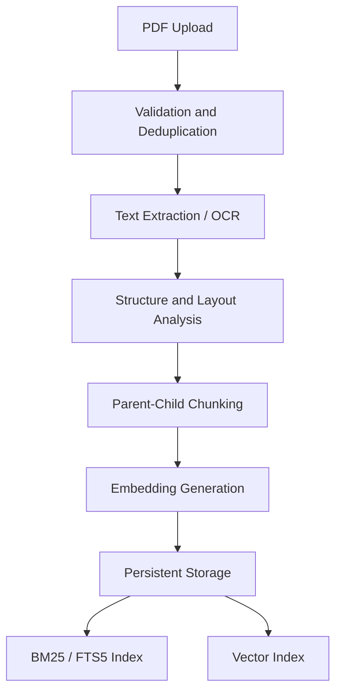
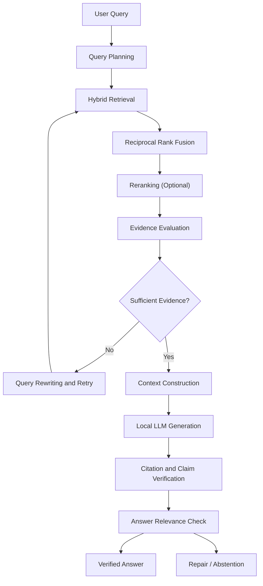

# Agentic RAG — Intelligent PDF Question Answering

**A CPU-efficient, evidence-grounded Agentic Retrieval-Augmented Generation system for intelligent PDF understanding, adaptive retrieval, and verified answer generation.**

<p align="center">
  <b>Local LLMs · Hybrid Search · Adaptive Retrieval · Citation Verification · CPU-Only</b>
</p>

---

## Overview

Agentic RAG is a document intelligence system that transforms PDF documents into a searchable knowledge base and answers complex questions using adaptive retrieval and evidence-based reasoning.

Unlike conventional RAG systems that follow a fixed retrieve-and-generate process, this system uses a bounded agent controller to evaluate retrieval quality, rewrite queries, retry unsuccessful searches, verify generated claims, and abstain when sufficient evidence is unavailable.

The entire pipeline is designed to run locally on CPU without requiring a GPU or paid API services.

## Key Features

- **Robust PDF Ingestion:** File validation, SHA-256 deduplication, crash recovery, and resumable processing.
- **Intelligent Document Processing:** Text extraction, optional OCR, reading-order recovery, heading detection, and table extraction.
- **Structure-Aware Chunking:** Parent-child chunking with section hierarchy and page-level provenance.
- **Hybrid Retrieval:** Combines BM25 keyword search and dense vector similarity.
- **Reciprocal Rank Fusion:** Combines retrieval rankings without requiring score calibration.
- **Adaptive Query Processing:** Intent classification, multi-part decomposition, metadata filtering, query rewriting, and bounded retries.
- **Evidence-Grounded Generation:** Generates answers using retrieved document evidence.
- **Citation Verification:** Validates citation existence and claim-to-evidence support.
- **Answer Relevance Evaluation:** Checks whether the generated answer actually addresses the original question.
- **Safe Abstention:** Avoids answering when sufficient evidence cannot be established.
- **Persistent Storage:** SQLite-based document, keyword, vector, and trace storage.
- **Evaluation Framework:** Retrieval metrics, answer quality, citation precision, latency, and memory measurements.

## System Architecture

The system consists of two major pipelines connected through a persistent knowledge base.

### 1. Document Ingestion Pipeline

PDF documents pass through validation, extraction, structural analysis, chunking, and embedding generation before being stored in searchable indexes.



### 2. Agentic Retrieval Pipeline

User queries are planned and processed through hybrid retrieval. The controller evaluates evidence coverage and initiates bounded query rewriting when retrieval is insufficient.



## Technology Stack

| Component | Technology |
|---|---|
| Programming Language | Python |
| PDF Processing | PyMuPDF |
| OCR | Tesseract (Optional) |
| Numerical Computing | NumPy |
| Keyword Retrieval | SQLite FTS5 / BM25 |
| Embeddings | BGE-small / Hashing Embedder |
| Vector Storage | SQLite BLOB + NumPy |
| Rank Fusion | Reciprocal Rank Fusion |
| Reranking | Cross-Encoder (Optional) |
| Local LLM | Ollama / llama.cpp |
| Extractive Fallback | Custom Extractive Generator |
| Database | SQLite |
| API | FastAPI |
| Monitoring | JSON Logging, psutil |

## Agentic Capabilities

The system uses a bounded state-machine controller rather than a fixed retrieval pipeline.

| Capability | Description |
|---|---|
| Query Planning | Understands query intent and decomposes multi-part questions. |
| Adaptive Retrieval | Evaluates whether retrieved evidence sufficiently covers the question. |
| Query Rewriting | Rewrites queries and relaxes filters when retrieval fails. |
| Bounded Execution | Limits retries, processing time, and context size. |
| Evidence Verification | Checks whether generated claims are supported by cited evidence. |
| Citation Repair | Attempts to associate unsupported citations with suitable evidence. |
| Answer Relevance | Evaluates question-to-answer relevance. |
| Abstention | Refuses to produce unsupported answers. |

## Robustness and Reliability

The architecture incorporates safeguards across the complete document lifecycle.

**Document-level protection**
- PDF signature and size validation.
- Encryption and page-count checks.
- SHA-256 duplicate detection.
- Atomic file storage.
- Resumable ingestion and crash recovery.
- Versioned indexes and automatic migration.
- Suspicious prompt-injection-like sentences quarantined before indexing.

**Retrieval-level protection**
- Hybrid keyword and semantic search.
- Parent-context expansion.
- Evidence coverage evaluation.
- Bounded retrieval retries.
- Time and context budgets.

**Answer-level protection**
- Citation existence checks.
- Claim-to-evidence support verification.
- Numeric consistency checks, including supported derived numbers.
- Contradiction checks using negation.
- Citation repair and answer relevance evaluation.
- Abstention when evidence is insufficient.

## Getting Started

### Requirements

- Python 3.10 or newer.
- A CPU-based machine.
- No GPU required.
- Internet access only for optional model downloads and package installation.

### Installation

Clone the repository:

```bash
git clone https://github.com/YOUR_USERNAME/YOUR_REPOSITORY.git
cd YOUR_REPOSITORY
```

Install the core dependencies:

```bash
pip install pymupdf numpy pandas pydantic psutil fastapi uvicorn python-multipart httpx
```

### Run the Notebook

Open the notebook:

```text
Local_Agentic_RAG_CPU_v2.ipynb
```

Run the cells sequentially.

The default configuration uses:
- Hashing-based embeddings.
- Extractive answer generation.
- SQLite persistent storage.
- CPU-only processing.

This configuration allows the complete pipeline to be tested without downloading an embedding model or LLM.

### Enable Real CPU Models

Set:

```python
INSTALL_OPTIONAL = True
```

Run the optional installation cell.

**Embedding model**

The system supports:

```text
BAAI/bge-small-en-v1.5
```

**LLM Option 1: Ollama**

Install Ollama and download a model:

```bash
ollama pull qwen2.5:3b
```

The notebook can automatically detect the local Ollama service.

**LLM Option 2: llama.cpp**

The notebook supports quantized GGUF models through llama.cpp.

Example configuration:

```python
Config(
    llm_backend="llamacpp",
    gguf_repo="Qwen/Qwen2.5-3B-Instruct-GGUF",
    gguf_file="qwen2.5-3b-instruct-q4_k_m.gguf"
)
```

All optional models run on CPU with GPU layers disabled.

## Configuration

The system exposes a centralized configuration class.

Important parameters include:

| Parameter | Default | Purpose |
|---|---:|---|
| `max_pdf_mb` | 50 | Maximum PDF size |
| `max_pages` | 600 | Maximum pages per PDF |
| `parent_chars` | 2400 | Parent chunk size |
| `child_chars` | 600 | Child chunk size |
| `top_k_dense` | 20 | Dense retrieval candidates |
| `top_k_bm25` | 20 | BM25 retrieval candidates |
| `final_k` | 6 | Final retrieval candidates |
| `max_retries` | 2 | Additional retrieval attempts |
| `min_coverage` | 0.55 | Minimum evidence coverage |
| `context_char_budget` | 6000 | Maximum evidence context |
| `support_threshold` | 0.60 | Claim support threshold |

Configuration can be customized without changing the underlying pipeline.

## Evaluation and Benchmarking

The notebook includes a golden-set evaluation framework to measure retrieval quality, answer reliability, resource consumption, and system stability.

### Evaluation Metrics

| Metric | Purpose |
|---|---|
| Recall@K | Measures retrieval effectiveness. |
| MRR | Measures ranking quality. |
| Answer Correctness | Measures generated answer accuracy against expected facts. |
| Answer Precision | Measures relevance of generated claims. |
| Citation Precision | Measures whether citations support the expected facts. |
| Faithfulness | Measures the share of generated claims passing verification. |
| Abstention Recall | Measures correct refusal of unanswerable questions. |
| Multi-Document Attribution | Checks whether answers cite the correct documents. |
| Multi-Turn Accuracy | Tests follow-up question handling. |
| Latency p50/p95 | Measures response-time distribution. |
| Peak RSS | Measures memory consumption. |

### Test Coverage

The evaluation framework includes:
- Factual questions.
- Numerical and table-based questions.
- Multi-part questions.
- Negation and contradiction cases.
- Page-filtered questions.
- Near-miss and unanswerable questions.
- Multi-document retrieval.
- Multi-turn conversations.

The default v2 golden set contains 39 questions: 30 answerable and 9 unanswerable.

**Important:** The default benchmark uses a locally generated demonstration corpus and the zero-download hashing embedder with extractive generation. Results on other documents and real models must be measured separately.

## FastAPI Service

An optional FastAPI interface exposes the RAG functionality.

| Method | Endpoint | Function |
|---|---|---|
| POST | `/documents` | Upload and ingest a PDF |
| GET | `/documents` | List documents |
| DELETE | `/documents/{id}` | Delete a document |
| POST | `/ask` | Ask questions |
| GET | `/health` | Check service health |
| GET | `/stats` | View system statistics |

The service uses the `X-Owner` header for document isolation.

**Security note:** Replace the example owner-header mechanism with proper authentication, such as JWT or API keys, before exposing the service publicly.

## Storage and Observability

Persistent data is stored in the configured data directory.

```text
rag_data/
├── pdfs/
├── logs/
│   └── app.jsonl
├── eval/
├── backups/
├── models/
└── rag.sqlite3
```

The system supports:
- Structured JSON logs.
- Retrieval and generation traces.
- Processing status tracking.
- Performance monitoring.
- SQLite backup and restore.
- Automatic recovery of interrupted ingestion jobs.

## Project Scope and Limitations

- The default hashing embedder is suitable for smoke testing but provides weaker semantic retrieval than a trained embedding model.
- CPU inference speed depends on the selected model and hardware.
- OCR requires the optional Tesseract installation.
- Cross-encoder reranking is optional because it adds CPU overhead.
- Evidence verification uses heuristic checks and cannot guarantee factual correctness.
- Benchmark results on synthetic documents do not guarantee performance on arbitrary real-world PDFs.

## Future Improvements

- Advanced table and multimodal document understanding.
- Better semantic and cross-document reasoning.
- Additional retrieval strategies.
- Improved evaluation on large real-world PDF collections.
- Optimized inference for low-resource environments.
- Expanded document formats and ingestion connectors.

## Contributing

Contributions, bug reports, and suggestions are welcome.

1. Fork the repository.
2. Create a feature branch.
3. Implement and test your changes.
4. Submit a pull request with a clear description.

## License

Choose and add an appropriate open-source license before publishing.

---

**Built with Python, local models, hybrid retrieval, and evidence-grounded AI.**
