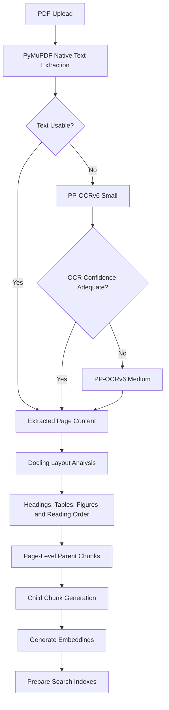
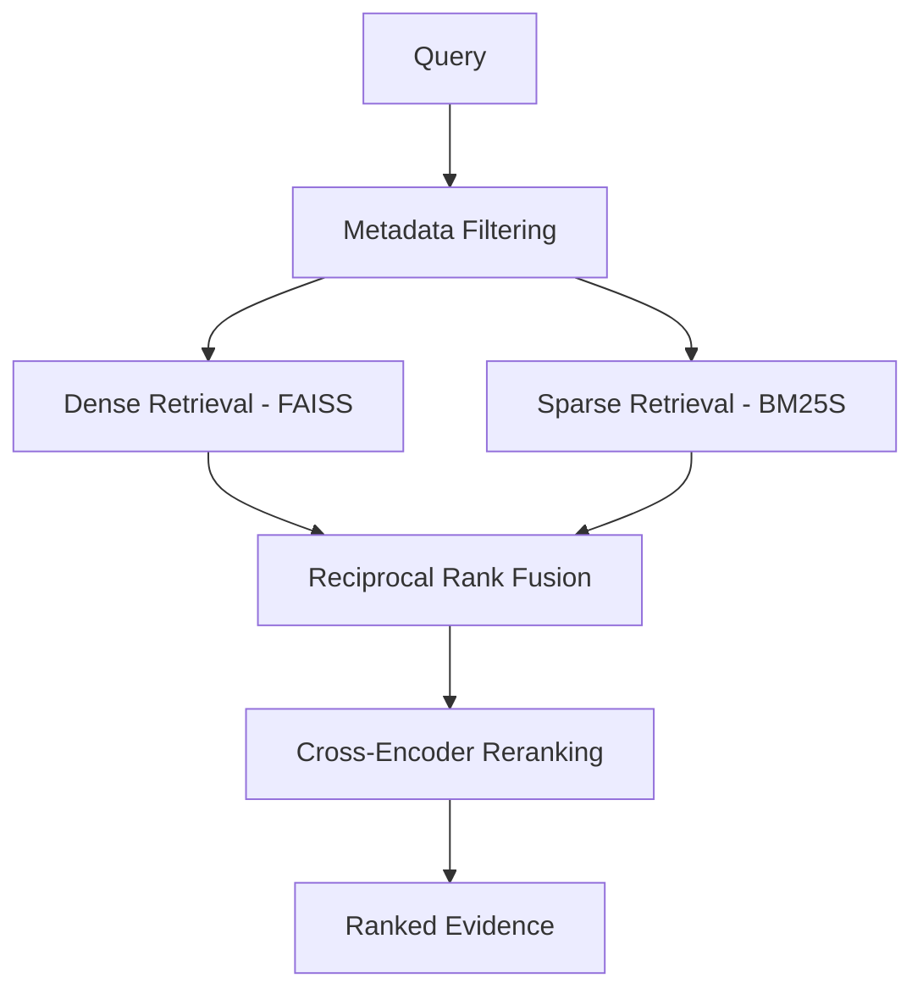
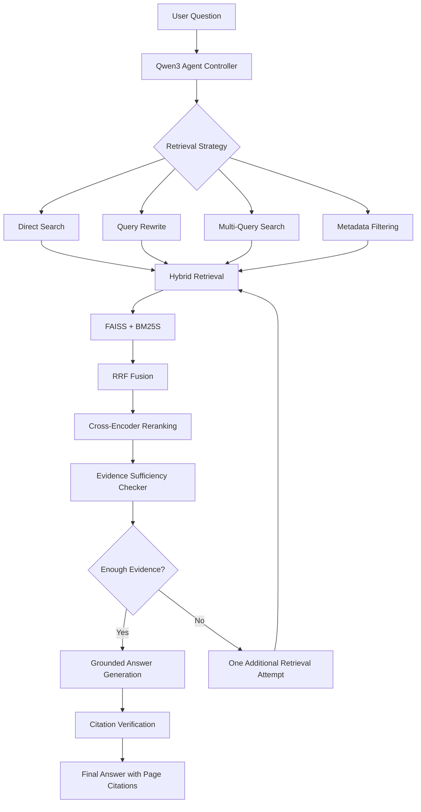

# Agentic RAG over PDFs

### Intelligent PDF Understanding with Adaptive Hybrid Retrieval and Evidence-Grounded Answer Generation

An Agentic Retrieval-Augmented Generation (RAG) system that transforms PDF documents into searchable knowledge and answers complex questions using local LLMs, hybrid retrieval, adaptive query planning, and page-level citation verification.

Built with **Qwen3, FAISS, BM25S, multilingual-e5-small, PyMuPDF, PP-OCRv6, Docling, and llama.cpp.**

---

## Overview

Traditional RAG systems typically follow a fixed retrieval and generation process. This project introduces an agent-controlled retrieval workflow that dynamically selects retrieval strategies based on the user's question.

The system can:
- Understand and classify user queries.
- Rewrite vague questions.
- Decompose complex questions into multiple queries.
- Apply page, section, and block-type metadata filters.
- Combine semantic and keyword-based retrieval.
- Rerank retrieved passages.
- Evaluate whether the retrieved evidence is sufficient.
- Perform one additional retrieval attempt when evidence is insufficient.
- Generate answers grounded in document content.
- Verify page-level citations against retrieved evidence.

The system uses Qwen3 locally through llama.cpp, with an optional Groq backend.

## Architecture

### 1. Document Ingestion Pipeline

The ingestion pipeline uses multiple extraction strategies to handle different PDF formats and preserve document structure.



**Document processing technologies:**

| Component | Technology | Purpose |
|---|---|---|
| Native extraction | PyMuPDF | Extract digital PDF text |
| OCR | PP-OCRv6 Small | Recover text from scanned pages |
| OCR fallback | PP-OCRv6 Medium | Improve extraction when needed |
| Layout analysis | Docling | Detect headings, tables, figures and reading order |
| Chunking | Custom parent-child chunking | Preserve context and improve retrieval |
| Embeddings | multilingual-e5-small | Semantic document representation |

### 2. Parent-Child Chunking

The system uses a hierarchical chunking strategy.

| Chunk type | Approximate size | Purpose |
|---|---:|---|
| Parent chunk | 1,500 characters | Preserves broader section context |
| Child chunk | 450 characters | Enables precise retrieval |

Key characteristics:
- Parent chunks are split at heading boundaries.
- Child chunks are sentence-aligned.
- Parents never cross page boundaries.
- Tables are split row-wise.
- Table headers are repeated in each table chunk.
- Page-level metadata is retained for citation generation.

When a child chunk is retrieved, its corresponding parent provides additional context to the LLM.

### 3. Hybrid Retrieval Engine

The retrieval engine combines dense semantic search and sparse keyword search.



**Retrieval components:**

| Component | Technology | Function |
|---|---|---|
| Dense retrieval | FAISS | Semantic similarity search |
| Embeddings | multilingual-e5-small | Query and document embeddings |
| Sparse retrieval | BM25S | Keyword-based retrieval |
| Metadata filtering | Custom filters | Restrict pages, sections and block types |
| Rank fusion | Reciprocal Rank Fusion | Combine dense and sparse rankings |
| Reranking | MiniLM Cross-Encoder | Improve candidate ordering |

Supported metadata filters include:
- Specific page numbers.
- Page ranges.
- Section-name matching.
- Block types, such as tables.

### 4. Agentic Retrieval and Answer Generation

The agent controller uses Qwen3 with specialized prompts for planning, evidence evaluation and answer generation.



**Controller capabilities:**

| Strategy | Purpose |
|---|---|
| Direct | Retrieve information for straightforward questions |
| Rewrite | Improve vague or poorly formulated queries |
| Multi-query | Decompose comparisons and multi-part questions |
| Metadata filter | Restrict retrieval to specified pages or sections |

The controller and evidence checker return structured JSON. Their outputs are validated before being used by the retrieval pipeline.

The system allows one additional retrieval attempt when the initial evidence is insufficient.

### 5. Evidence Verification

The answer generator uses only retrieved document evidence.

Generated answers contain page-level citations in the `[p.N]` format.

The system checks:
- Whether cited evidence exists.
- Whether cited pages correspond to retrieved passages.
- Whether generated claims are supported by the evidence.
- Whether the answer remains grounded in the source document.

Unsupported or insufficiently grounded answers are not treated as verified responses.

---

## Technology Stack

| Layer | Technology |
|---|---|
| Runtime | Google Colab |
| Language | Python |
| Local LLM | Qwen3-4B-Instruct |
| LLM inference | llama.cpp |
| Optional hosted inference | Groq |
| PDF extraction | PyMuPDF |
| OCR | PP-OCRv6 |
| Layout processing | Docling |
| Embedding model | multilingual-e5-small |
| Dense index | FAISS |
| Sparse retrieval | BM25S |
| Reranking | MiniLM Cross-Encoder |
| Rank fusion | Reciprocal Rank Fusion |
| Storage | Google Drive / JSONL artifacts |

## Getting Started

### Requirements

- Google Colab.
- Recommended: T4 GPU runtime.
- Google Drive for model caching and artifacts.
- Hugging Face token for model downloads.
- Python dependencies installed through the notebook.

CPU execution is possible, but local Qwen3-4B inference may be considerably slower.

### 1. Clone the repository

```bash
git clone https://github.com/YOUR_USERNAME/YOUR_REPOSITORY.git
cd YOUR_REPOSITORY
```

### 2. Open the notebook

Open:

`Agentic_RAG_Pipeline_(2).ipynb`

Upload it to Google Colab or open it from your GitHub repository.

### 3. Configure credentials

Add `HF_TOKEN` through Google Colab Secrets and enable notebook access.

A `GROQ_API_KEY` is required only if you choose the optional Groq backend.

### 4. Configure the PDF

Set the PDF path in the configuration cell:

```python
PDF_PATH = "/content/my_document.pdf"
```

### 5. Run the notebook

Execute the cells sequentially.

The notebook handles:
- PDF extraction and OCR.
- Document layout analysis.
- Chunk generation.
- Embedding generation.
- FAISS and BM25S indexing.
- Agentic retrieval.
- Evidence verification.
- Answer generation.

## Generated Artifacts

The ingestion pipeline produces structured JSONL outputs:

| File | Purpose |
|---|---|
| `page_records.jsonl` | Extracted page-level content |
| `child_chunks.jsonl` | Searchable child chunks |
| `ocr_page_diagnostics.jsonl` | OCR processing diagnostics |

The artifacts retain page-level information to support retrieval and citation generation.

## Evaluation

The project includes a question-answering evaluation workflow.

Evaluation covers:
- Direct factual questions.
- Vague questions requiring rewriting.
- Multi-query and comparison questions.
- Page-specific questions.
- Table-related questions.
- Answer correctness against reference answers.
- Optional LLM-based answer judging.

The evaluation workflow also supports manually supplied PDF and JSON benchmark files.

## Robustness Features

**Document robustness**
- Native extraction with conditional OCR fallback.
- Escalation from PP-OCRv6 Small to Medium.
- Layout-aware extraction.
- Page-level chunk boundaries.
- Table-aware chunking.

**Retrieval robustness**
- Dense and sparse retrieval.
- Metadata filtering within retrieval.
- Reciprocal Rank Fusion.
- Cross-encoder reranking.
- Adaptive query strategies.
- One additional retrieval attempt.

**Generation reliability**
- Structured controller outputs.
- Validated retrieval plans.
- Evidence sufficiency checking.
- Grounded answer generation.
- Page-level citation verification.

## Limitations

- Qwen3-4B local inference can be slow on CPU.
- OCR and layout processing increase ingestion time.
- Cross-encoder reranking adds computational overhead.
- Evidence verification reduces unsupported answers but does not guarantee factual correctness.
- The additional retrieval attempt is bounded to one retry.

## Future Improvements

- More efficient local inference.
- Improved multilingual document understanding.
- Advanced table and figure retrieval.
- Larger-scale document collections.
- More comprehensive retrieval and citation benchmarks.
- Multi-document reasoning and cross-document evidence synthesis.

## License

Add an appropriate open-source license before public distribution.

---

**Agentic RAG over PDFs — From document ingestion to evidence-grounded answers.**
